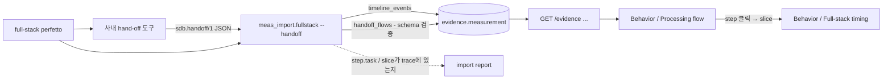

# Processing flow (hand-off flow) JSON 설계

사내 도구는 지금까지 시나리오마다 hand-off 순서를 html로 출력했다. html은 실행 코드를 담을 수 있어서
DB에 넣거나 화면에 그대로 띄우면 보안 경계(경로 · iframe · CSP)를 따로 관리해야 한다. 그래서 html 대신
**정해진 JSON format**을 받아 evidence에 적재하고, 화면은 Scenario DB UI가 직접 그린다.

| 항목 | html을 띄우는 방식 | JSON 적재 (채택) |
|---|---|---|
| 보안 | 파일 서빙, sandbox iframe, CSP가 필요 | 값만 저장하고 React가 escape해서 그림 |
| 검증 | 형식이 없음 | Pydantic schema로 ETL할 때 거부 |
| 화면 통일 | 사내 화면 그대로 | Full-stack timing · Cadence와 같은 색 · 용어 · 선택 연동 |
| 검색 · 비교 | 불가 | step · cadence 단위로 query 가능 |
| 원본 보존 | html 파일 | `provenance.raw_artifacts`에 생성 도구 출력 경로와 sha256만 기록 |

## 데이터 흐름



`handoff_flows`가 없는 evidence도 Processing flow 탭을 쓸 수 있다. 이때 UI는 full-stack trace에서 선택한 slice의
chain을 같은 모델로 바꿔 같은 렌더러로 그린다.

## Format `sdb.handoff/1`

```yaml
handoff_flows:
  format: sdb.handoff/1
  generator: in-house-handoff 0.3        # 선택
  participants:                          # 화면의 세로줄. 계층(layer) 하나에 여러 참여자
    - {id: fwk.cs, layer: framework, name: cameraserver, detail: RequestThread · buffer return}
    - {id: hw.isp, layer: hw, name: ISP, detail: CSIS → MCSC}
  cadences:                              # 시나리오 안의 모든 주기
    - {id: frame, name: Sensor frame, kind: frame,  period_ms: 33.333}
    - {id: vsync, name: Display vsync, kind: vsync, period_ms: 16.667}
    - {id: od,    name: VPS_OD,      kind: divided, of: frame, every: 5}   # 6 fps
    - {id: abox,  name: ABOX period,  kind: period, period_ms: 20}
    - {id: mux,   name: MPEG4 chunk,  kind: chunk,  period_ms: 1000}
    - {id: touch, name: Touch input,  kind: event}                          # 비주기
  flows:                                 # 한 단위(frame · buffer · period)의 순서
    - id: rec-frame
      name: 녹화 frame
      cadence: frame
      summary: request → sensor → ISP → EIS → GDC → MFC → MPEG4Writer
      steps:
        - {to: fwk.csreq, call: processCaptureRequest, task: cs.request, t_ms: 0, dur_ms: 0.3, frame_offset: -4}
        - {from: fwk.csreq, to: hal.cam, call: request, task: hal.request, handoff: ipc, t_ms: 0.35, dur_ms: 2.3}
        - {note: SOF n · sensor valid 10.2 ms, over: [hw.sensor, hw.isp]}
        - {from: hal.cam, to: fwk.cs, call: result, task: cs.return, handoff: ipc, branch: preview, t_ms: 48.1, dur_ms: 0.3}
        - {from: hw.isp, to: hw.vps, call: OD kick, task: vps.od, node: vps_od, every: 5, cadence: od, t_ms: 11.5, dur_ms: 1.8}
```

| 필드 | 규칙 |
|---|---|
| `participants[].layer` | `app` `framework` `hal` `kernel` `fw` `hw` 중 하나 |
| `cadences[].kind` | `frame` `vsync` `period` `chunk`는 `period_ms`가 필수다. `divided`는 `of`와 `every`(2 이상)로 정한다. `event`는 주기가 없다. |
| `flows[].cadence` | 이 단위가 반복되는 주기 |
| `steps[]` 호출 | `to`는 필수다. `from`이 없으면 이 단위의 시작이다. `from == to`면 같은 참여자 안의 처리다. |
| `steps[]` 메모 | `note`와 `over`(참여자 1개 이상)만 둔다. |
| `handoff` | `kick` `complete` `ipc` `irq` `data` 중 하나이고 기본값은 `data`다. full-stack trace의 `sdb.handoff`와 같다. |
| `task` · `slice` | `task`는 timing perfetto와 공유하는 공통 name이다. `slice`는 같은 evidence의 `timeline_events[].task_id`다. 둘 다 선택이다. |
| `node` | Pipeline timing에 나오는 node id다. 화면에서 ★로 표시한다. |
| `cadence` · `every` · `frame_offset` | 그 step이 단위의 주기와 다를 때 쓴다. 다른 주기로 넘어가거나, N 단위에 한 번 실행되거나, 몇 frame 앞서 실행되는 경우다. |
| `branch` | 연속된 같은 `branch` step은 `par` 블록 하나가 된다. 예: preview / encode. |
| `t_ms` · `dur_ms` | 단위 시작 기준 시각과 실행 시간이다. 대기 Δ는 화면에서 계산한다. |

정의되지 않은 필드, 없는 참여자 · cadence 참조, 같은 id 중복은 ETL할 때 거부한다.

## 저장

- `evidence.handoff_flows` JSONB column (alembic `0033`)
- `MeasurementEvidence.handoff_flows: HandoffDoc | None`
- API는 evidence 응답에 그대로 포함

## 화면 (Behavior / Processing flow)

탭 이름은 다른 두 탭(Full-stack timing, Cadence)과 맞춰 영어로 쓴다. 형식은 이전 mockup의 hand-off sequence를 따른다.

| 요소 | 표시 |
|---|---|
| 단위 선택 | 기본은 `All loops`다. 모든 flow를 공통 열 위에 쌓고, 각 flow를 자기 loop 테두리로 감싼다. flow 버튼마다 주기(Hz)를 함께 표시한다. |
| loop 테두리 | `loop [Sensor frame · 30 Hz] frame loop`처럼 단위와 loop 종류를 표시한다. 종류는 frame loop · vsync loop · independent loop · slow chunk loop · every N-th · event-driven이다. frame에 묶인 loop는 실선 청록, 독립 loop는 주황 점선이다. |
| 하위 loop | 한 flow 안에서 다른 주기로 도는 step(예: vsync scanout, AAC, VPS_OD ÷5)은 안쪽 loop 테두리로 감싸고 오른쪽 배지에도 표시한다. |
| Loops 줄 | 시나리오의 모든 cadence를 rate 순으로 보여 준다. 그 아래에 loop 사이에 넘겨주는 지점과 넘겨주는 호출을 적는다. 예: `ABOX period · 50 Hz → AAC frame · 47 Hz via AAC encode`. |
| 열 | 기본은 계층 6열(`Layer`)이다. `Process`로 바꾸면 모든 계층을 process 단위로 펼친다. 머리글의 계층 띠(`▸ HW · 10`)를 누르면 그 계층만 펼치거나 접는다. process가 하나뿐인 계층은 띠를 눌러도 바뀌지 않는다. 지금 보는 flow가 쓰는 process만 열이 된다. |
| 행 | 자동 번호, 시각 t, 대기 Δ, 호출 이름, 공통 name, 실행 시간을 보여 준다. 열이 많아 가로로 스크롤해도 번호 · Δ는 왼쪽에, t · rate 배지는 오른쪽에 고정된다. ★는 Pipeline node다. 한 participant 안에서 이어지는 단계(CSIS → MLSC)는 한 행으로 접는다. |
| 화살표 | 시작시킴(kick) · 넘김(ipc · data)은 실선, 완료 · IRQ는 점선이다. 색은 Full-stack timing과 같다. |
| par | preview / encode처럼 갈라지는 구간은 par 블록으로 묶는다. |
| 요약 | flow 하나일 때는 end-to-end, 선행 시간, 동시에 진행 중인 단위 수(= ⌈e2e / 주기⌉), HW · SW 실행 합을 보여 준다. All loops일 때는 loop 종류별 개수를 보여 준다. |
| 연동 | `slice`가 있는 행을 누르면 Full-stack timing에서 그 slice를 연다. |

App이 관여하는 loop도 flow로 표현한다. 예를 들어 camera는 Camera UI(App main → RenderThread → SurfaceFlinger)를 별도 loop로 둔다. audio는 App이 MediaRecorder 제어만 하고 주기 처리는 audioserver · mediaserver가 한다는 점을 메모로 표시한다. YouTube는 Player tick에서 AudioTrack에 write하고, AudioFlinger mix(20 ms)와 ABOX(10 ms)가 독립적으로 돈다.

## Cadence 탭: 주기의 근거

trace slice 자체에는 주기가 없으므로 아래 순서로 정하고, 표의 `근거` 열과 popover에 그 출처를 표시한다.

| 근거 | 출처 | 신뢰도 |
|---|---|---|
| 문서 | hand-off 문서가 선언한 loop (step `cadence`, 없으면 flow `cadence`) | 선언값 |
| capture | import 때 전체 trace에서 잰 같은 공통 name의 시작 간격 중앙값 (`cadence_period_ms`) | 긴 capture면 안정적 |
| frame | frame 경로 task의 frame 간 간격 | 안정적 |
| 창 추정 | 표시 창 안의 간격 | 창이 짧으면 부정확 |
| 차용 | 창 안에서 한 번만 보인 frame 경로 task는 frame 주기를 빌려 씀 | 가정 |

aperiodic(event-driven) 작업, burst, 주기 변경(예: UI 애니메이션 중 vsync, 평소 1 Hz)은 median 간격만으로 구분되지 않는다. 그래서 문서 선언을 가장 우선한다.


## 시나리오 확장

| 시나리오 | 단위 (cadence) |
|---|---|
| Camera 녹화 | sensor frame 30 Hz, preview → vsync 60 Hz, VPS_OD ÷5, ABOX 20 ms, AAC 1024 sample, Camera UI (App), MPEG4 chunk 1 s |
| YouTube | video frame 30 Hz, ExoPlayer tick 10 ms (AudioTrack write), AudioFlinger mix 20 ms, ABOX 10 ms, vsync 60 Hz, network segment |
| Local playback | video frame 30 Hz, extractor read chunk, vsync 60 Hz |
| Game | game frame 60 Hz, touch input (event · 240 Hz sampling), vsync 60 Hz |
| 다른 SoC (예) | Pro video histogram M2M scaler 6 fps: `divided` 또는 `period` cadence 하나와 flow 하나를 추가하면 된다 |

## Fixture (Exynos2600)

`scripts/generate_fullstack_trace_fixture.py`가 네 시나리오의 합성 full-stack trace와 `handoff_flows`를 같은 task
정의로 생성한다. 값은 fixture 가정이고 silicon data가 아니다(`data_origin: synthetic`).
